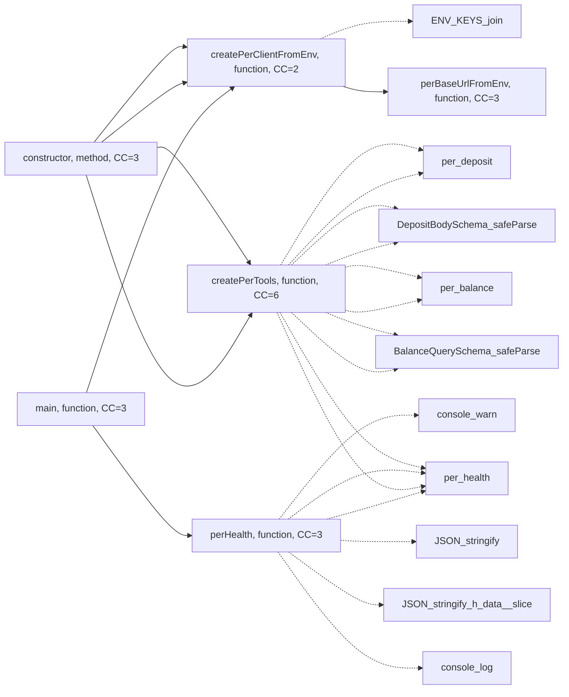
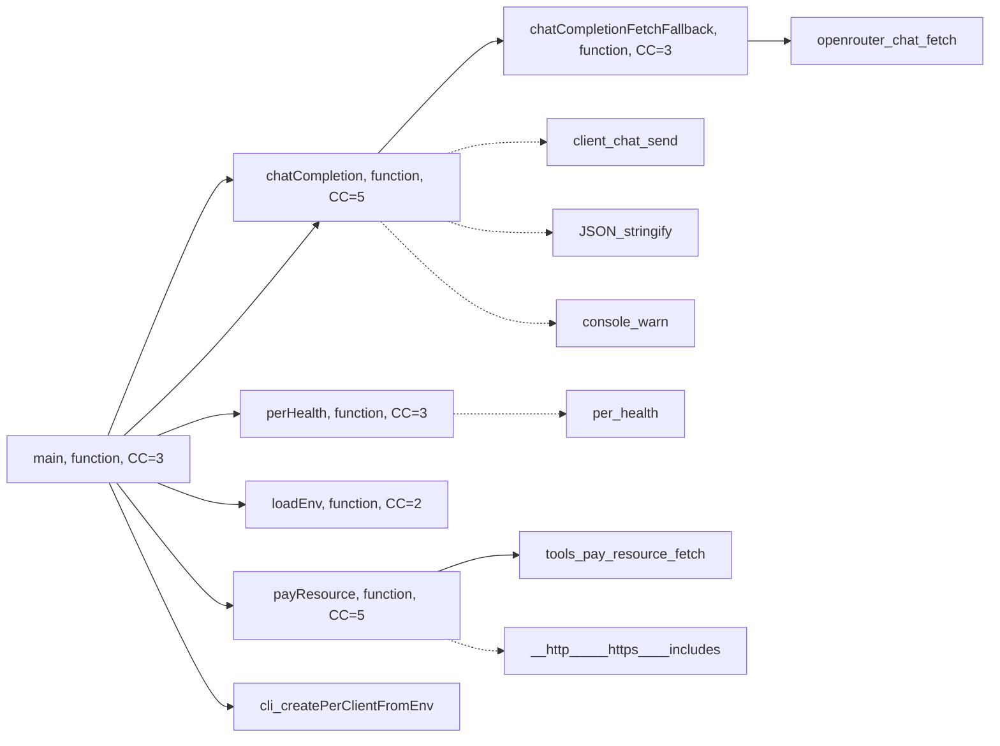
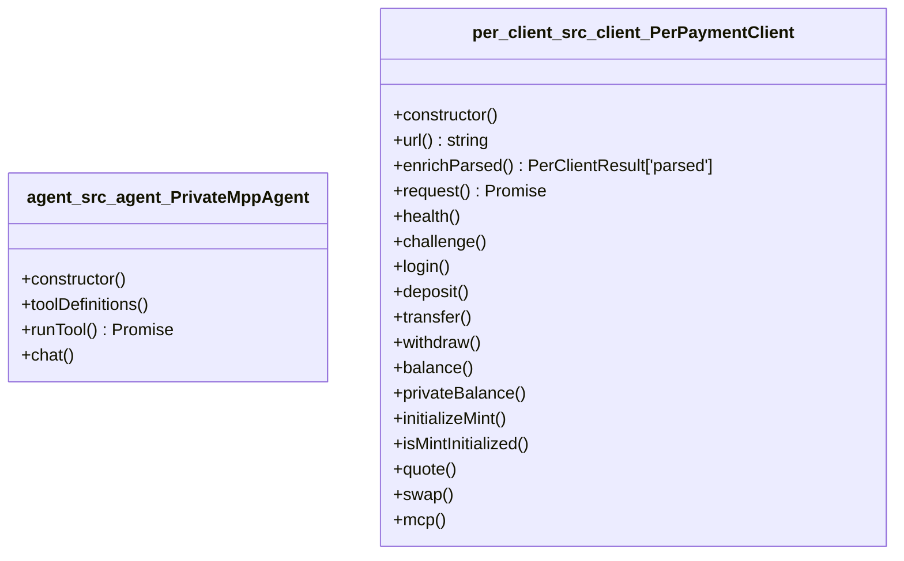
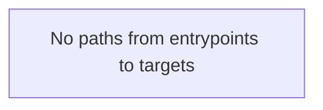

# Diagramming-Code — PrivateMPP

> Generated by the **diagramming-code** skill via official tooling
> (`uv run --python 3.12 ~/.claude/skills/diagramming-code/scripts/diagram.py`).
> Backed by `trailmark 0.3.0`. Language: `typescript`.
> Run on: Friday, May 8, 2026 — `cd /Users/macbook/PrivateMPP`.

The skill rule was honored: official tooling is preferred, no hand-drawn Mermaid is added beyond what the official script emits. All diagrams below are **verbatim stdout** from `diagram.py`.

---

## Tool inventory

```bash
$ uv run --python 3.12 ~/.claude/skills/diagramming-code/scripts/diagram.py --help
usage: diagram [-h] --target TARGET [--language LANGUAGE] --type
               {call-graph,class-hierarchy,module-deps,containment,complexity,data-flow}
               [--focus FOCUS] [--depth DEPTH] [--direction {TB,LR}]
               [--threshold THRESHOLD]
```

I exercised five of the six diagram types. `data-flow` was attempted but produced `No paths from entrypoints to targets` — included below for transparency.

---

## 1. Module-deps — **NOT GENERATED** (caveat)

Attempted twice, on two roots, both came back empty:

```bash
uv run --python 3.12 ~/.claude/skills/diagramming-code/scripts/diagram.py \
  --target packages --language typescript --type module-deps --direction LR
uv run --python 3.12 ~/.claude/skills/diagramming-code/scripts/diagram.py \
  --target apps/web  --language typescript --type module-deps --direction LR
```


**Cause:** trailmark 0.3.0's TypeScript frontend resolves *call edges* across files but does not currently emit module-level `import` edges for this monorepo (workspace `@private-mpp/*` aliases and ESM `NodeNext` resolution). The `Dependencies:` line in `TRAILMARK_SUMMARY.md` is the authoritative module-graph fact for now.

If/when the resolver gains workspace import support, re-run the same command and replace this section.

---

## 2. Call-graph — `createPerTools` (agent's PER tool factory)

Real exported function discovered with `rg "^export (async )?function" packages/agent/src` → `createPerTools` is the highest-CC export in the agent package (CC=6) and is invoked by the CLI entrypoint.

```bash
uv run --python 3.12 ~/.claude/skills/diagramming-code/scripts/diagram.py \
  --target packages --language typescript --type call-graph \
  --focus createPerTools --depth 3 --direction LR
```



**Reading:** `cli:main` → `PrivateMppAgent.constructor` → `createPerTools` defines the full tool surface (`per_health`, `per_balance`, `per_deposit`) and is the single chokepoint for adding/removing agent-callable PER operations. The dotted arrows are unresolved external calls (Zod schema methods, console).

---

## 3. Call-graph — `chatCompletion` (agent's LLM bridge)

```bash
uv run --python 3.12 ~/.claude/skills/diagramming-code/scripts/diagram.py \
  --target packages/agent/src --language typescript --type call-graph \
  --focus chatCompletion --depth 3 --direction LR
```



**Reading:** `chatCompletion` calls the OpenRouter SDK (`client.chat.send`) and falls through to a raw `fetch` wrapper (`chatCompletionFetchFallback → fetch`) when the SDK throws. The CLI's `main` is the only caller. `payResource` lives on the same call surface and reaches `fetch` directly — a privileged outbound path for the agent.

---

## 4. Containment (class diagram)

```bash
uv run --python 3.12 ~/.claude/skills/diagramming-code/scripts/diagram.py \
  --target packages --language typescript --type containment --direction LR
```



**Reading:** Two classes total. `PerPaymentClient` exposes the full PER REST surface (matches the table in `docs/architecture-low-level.md`). `PrivateMppAgent` is intentionally thin — orchestration only; no money-moving logic in the class itself.

---

## 5. Complexity heat-map (full `packages/`)

```bash
uv run --python 3.12 ~/.claude/skills/diagramming-code/scripts/diagram.py \
  --target packages --language typescript --type complexity --threshold 1 --direction LR
```

(Truncated to nodes + the most informative edges; the script printed CSS classes `low/medium/high` based on CC.)

```mermaid
flowchart LR
    agent_src_agent_PrivateMppAgent_constructor["constructor, method, CC=3"]:::low
    agent_src_agent_PrivateMppAgent_toolDefinitions["toolDefinitions, method, CC=1"]:::low
    agent_src_agent_PrivateMppAgent_runTool["runTool, method, CC=2"]:::low
    agent_src_agent_PrivateMppAgent_chat["chat, method, CC=2"]:::low
    agent_src_cli_loadEnv["loadEnv, function, CC=2"]:::low
    agent_src_cli_perHealth["perHealth, function, CC=3"]:::low
    agent_src_cli_main["main, function, CC=3"]:::low
    agent_src_openrouter_chat_chatCompletion["chatCompletion, function, CC=5"]:::medium
    agent_src_openrouter_chat_chatCompletionFetchFallback["chatCompletionFetchFallback, function, CC=3"]:::low
    agent_src_tools_createPerTools["createPerTools, function, CC=6"]:::medium
    agent_src_tools_pay_resource_payResource["payResource, function, CC=5"]:::medium
    mpp_bridge_src_env_loadBridgeEnv["loadBridgeEnv, function, CC=2"]:::low
    mpp_bridge_src_middleware_sketch_createPaidResourceHandler["createPaidResourceHandler, function, CC=2"]:::low
    mpp_bridge_src_mppx_server_createTempoDemoMppx["createTempoDemoMppx, function, CC=1"]:::low
    mpp_bridge_src_settle_settleAfterVerifiedCredential["settleAfterVerifiedCredential, function, CC=1"]:::low
    per_client_src_client_parseJsonSafe["parseJsonSafe, function, CC=3"]:::low
    per_client_src_client_qs["qs, function, CC=4"]:::low
    per_client_src_client_PerPaymentClient_constructor["constructor, method, CC=1"]:::low
    per_client_src_client_PerPaymentClient_url["url, method, CC=2"]:::low
    per_client_src_client_PerPaymentClient_enrichParsed["enrichParsed, method, CC=4"]:::low
    per_client_src_client_PerPaymentClient_request["request, method, CC=2"]:::low
    per_client_src_client_PerPaymentClient_health["health, method, CC=1"]:::low
    per_client_src_client_PerPaymentClient_challenge["challenge, method, CC=1"]:::low
    per_client_src_client_PerPaymentClient_login["login, method, CC=1"]:::low
    per_client_src_client_PerPaymentClient_deposit["deposit, method, CC=1"]:::low
    per_client_src_client_PerPaymentClient_transfer["transfer, method, CC=2"]:::low
    per_client_src_client_PerPaymentClient_withdraw["withdraw, method, CC=1"]:::low
    per_client_src_client_PerPaymentClient_balance["balance, method, CC=1"]:::low
    per_client_src_client_PerPaymentClient_privateBalance["privateBalance, method, CC=1"]:::low
    per_client_src_client_PerPaymentClient_initializeMint["initializeMint, method, CC=1"]:::low
    per_client_src_client_PerPaymentClient_isMintInitialized["isMintInitialized, method, CC=1"]:::low
    per_client_src_client_PerPaymentClient_quote["quote, method, CC=1"]:::low
    per_client_src_client_PerPaymentClient_swap["swap, method, CC=2"]:::low
    per_client_src_client_PerPaymentClient_mcp["mcp, method, CC=1"]:::low
    per_client_src_client_perBaseUrlFromEnv["perBaseUrlFromEnv, function, CC=3"]:::low
    per_client_src_client_createPerClientFromEnv["createPerClientFromEnv, function, CC=2"]:::low
    per_client_src_mpp_custom_stub_verifyPerBackedCredentialStub["verifyPerBackedCredentialStub, function, CC=1"]:::low
    per_client_src_schemas_tryParseHealth["tryParseHealth, function, CC=2"]:::low
    per_client_src_schemas_tryParseSplBalance["tryParseSplBalance, function, CC=2"]:::low
    agent_src_agent_PrivateMppAgent_constructor --> per_client_src_client_createPerClientFromEnv
    agent_src_agent_PrivateMppAgent_constructor --> agent_src_tools_createPerTools
    agent_src_cli_main --> agent_src_cli_loadEnv
    agent_src_cli_main --> per_client_src_client_createPerClientFromEnv
    agent_src_cli_main --> agent_src_cli_perHealth
    agent_src_cli_main --> agent_src_tools_pay_resource_payResource
    agent_src_cli_main --> agent_src_openrouter_chat_chatCompletion
    agent_src_openrouter_chat_chatCompletion --> agent_src_openrouter_chat_chatCompletionFetchFallback
    per_client_src_client_PerPaymentClient_request --> per_client_src_client_PerPaymentClient_url
    per_client_src_client_PerPaymentClient_request --> per_client_src_client_parseJsonSafe
    per_client_src_client_PerPaymentClient_request --> per_client_src_client_PerPaymentClient_enrichParsed
    classDef low fill:rgba(40,167,69,0.2),stroke:#28a745,color:#28a745
    classDef medium fill:rgba(255,193,7,0.2),stroke:#e6a817,color:#e6a817
    classDef high fill:rgba(220,53,69,0.2),stroke:#dc3545,color:#dc3545
```

**Reading:** No `high` (red) functions. Three medium (yellow) — `createPerTools` (CC=6), `chatCompletion` (CC=5), `payResource` (CC=5). Everything else is `low`. This matches the hotspot table in `TRAILMARK_STRUCTURAL.md`.

---

## 6. Data-flow — empty result (transparent)

```bash
uv run --python 3.12 ~/.claude/skills/diagramming-code/scripts/diagram.py \
  --target packages --language typescript --type data-flow --direction LR
```



**Reading:** trailmark 0.3.0 needs explicit attack-surface tagging to draw a data-flow path. Without the structural passes (`taint`, `privilege_boundary`) discussed in `TRAILMARK_STRUCTURAL.md`, this query has no targets to reach. Re-attempt once those passes ship.

---

## How to reproduce

```bash
uv run --python 3.12 ~/.claude/skills/diagramming-code/scripts/diagram.py \
  --target packages --language typescript --type call-graph \
  --focus createPerTools --depth 3 --direction LR

uv run --python 3.12 ~/.claude/skills/diagramming-code/scripts/diagram.py \
  --target packages/agent/src --language typescript --type call-graph \
  --focus chatCompletion --depth 3 --direction LR

uv run --python 3.12 ~/.claude/skills/diagramming-code/scripts/diagram.py \
  --target packages --language typescript --type containment --direction LR

uv run --python 3.12 ~/.claude/skills/diagramming-code/scripts/diagram.py \
  --target packages --language typescript --type complexity --threshold 1 --direction LR
```
