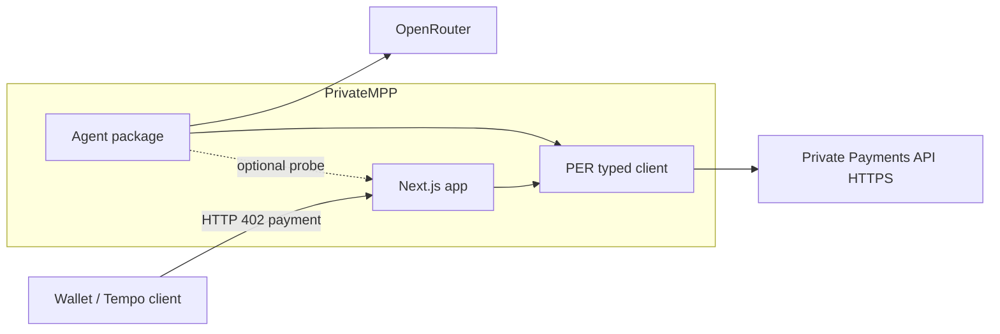
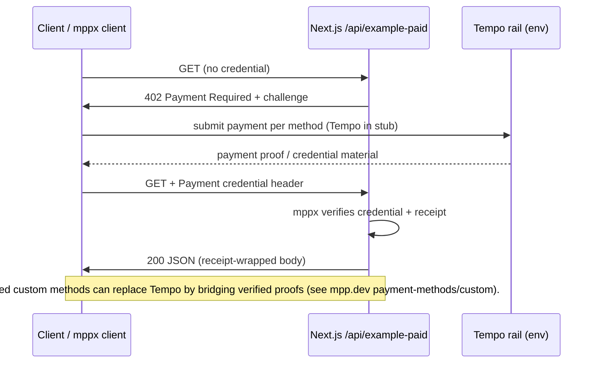

# Architecture — High Level (C4-style)

## Context (system)

Plain-language equivalent:

- **Agent** (`@private-mpp/agent`) may call **OpenRouter** for reasoning and **PER** for payment-related HTTP operations via typed tools.
- **Web** (`apps/web`) exposes **local health**, **PER health proxy**, and a **payment-gated** example route using **`mppx/server`** (Tempo in the stub).
- **PER** is accessed over **HTTPS** only; keys stay in environment / secret stores—never in source control.

## Containers

| Container | Responsibility | Trust boundary |
|-----------|----------------|----------------|
| Next.js (`apps/web`) | Route handlers, optional PER proxy, **402** challenge issuance via `mppx` | Public HTTP surface; validates payment receipts before returning protected JSON |
| Agent (`packages/agent`) | OpenRouter SDK, PER tools with Zod | Must not expose signing keys; tools do not fetch arbitrary user URLs without allowlists |
| PER client (`packages/per-client`) | Typed `fetch` wrapper, Zod for stable schemas | Treat all JSON as untrusted; redact logs |
| Integrations (`packages/integrations`) | Marketplace **stub** interfaces | No external calls |

## Data flows — challenge → pay → retry

## Optional MCP transport

PER exposes **POST /mcp** (stateless Streamable HTTP MCP) per MagicBlock docs. Agents or automation may call MCP **instead of** or **alongside** REST. This repo keeps MCP as a **client method** on `PerPaymentClient`—transport selection belongs in deployment config.

## References

- MagicBlock PER introduction: [docs.magicblock.gg — PER API introduction](https://docs.magicblock.gg/pages/private-ephemeral-rollups-pers/api-reference/per/introduction)
- Public OpenAPI reference hub: [payments.magicblock.app/reference](https://payments.magicblock.app/reference)
- MPP / `mppx` TypeScript SDK: [mpp.dev/sdk/typescript](https://mpp.dev/sdk/typescript)
- OpenRouter TypeScript SDK (beta): [openrouter.ai/docs](https://openrouter.ai/docs/agent-sdk/typescript/overview)
