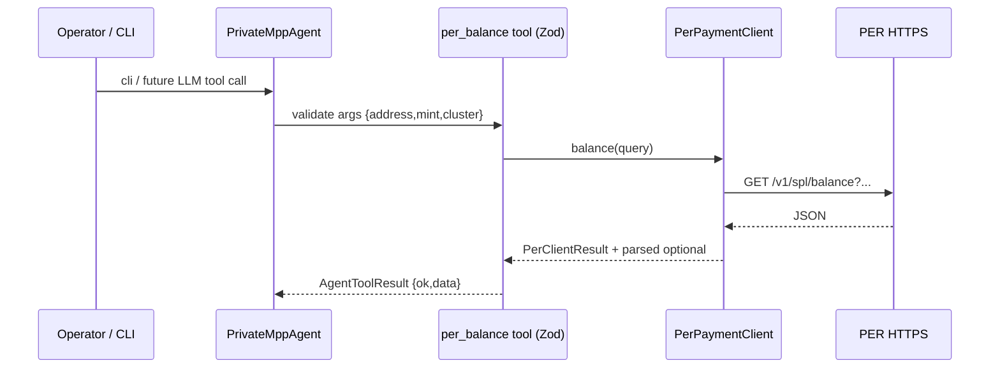

# Architecture — Low Level

## Monorepo packages

| Package | Path | Role |
|---------|------|------|
| `@private-mpp/per-client` | `packages/per-client` | `PerPaymentClient`, Zod helpers, `PER_API_PATHS`, MPP custom stubs |
| `@private-mpp/mpp-bridge` | `packages/mpp-bridge` | `createTempoDemoMppx`, `createPaidResourceHandler`, `settleAfterVerifiedCredential` (stub) |
| `@private-mpp/agent` | `packages/agent` | `PrivateMppAgent`, OpenRouter, PER tools, `pay_resource` |
| `@private-mpp/web` | `apps/web` | Next.js App Router, `/api/*` routes |

## Environment variables (summary)

| Variable | Used by | Purpose |
|----------|---------|---------|
| `PER_PRIVATE_PAYMENT_BASE_URL` | per-client, web proxy | PER HTTPS base (alias: `PER_API_BASE`) |
| `MPP_SECRET_KEY` | `apps/web` mppx route | Verify/issue payment credentials (keep secret) |
| `MPP_TEMPO_CURRENCY`, `MPP_TEMPO_RECIPIENT` | `apps/web` | Tempo addresses for example-paid |
| `OPENROUTER_API_KEY` | agent | LLM API key |
| `NEXT_PUBLIC_APP_NAME` | web (optional) | Public label |

## PER endpoints → client methods

Public docs list **GET /health**, **GET /v1/spl/challenge?pubkey=**, **POST /v1/spl/login**, SPL routes under **`/v1/spl/*`**, **POST /mcp**, etc. ([introduction](https://docs.magicblock.gg/pages/private-ephemeral-rollups-pers/api-reference/per/introduction))

| HTTP | `PerPaymentClient` method |
|------|---------------------------|
| GET /health | `health()` |
| GET /v1/spl/challenge | `challenge(pubkey)` |
| POST /v1/spl/login | `login(body)` |
| POST /v1/spl/deposit | `deposit(body)` |
| POST /v1/spl/transfer | `transfer(body, { bearerToken })` |
| POST /v1/spl/withdraw | `withdraw(body)` |
| GET /v1/spl/balance | `balance({ address, mint, cluster })` |
| GET /v1/spl/private-balance | `privateBalance(query, bearerToken)` |
| POST /v1/spl/initialize-mint | `initializeMint(body)` |
| GET /v1/spl/is-mint-initialized | `isMintInitialized({ mint, cluster })` |
| POST /v1/spl/quote | `quote(body)` |
| POST /v1/spl/swap | `swap(body, { bearerToken })` |
| POST /mcp | `mcp(body)` |

## Sequence — agent tool calling PER (balance)

## Error handling

- HTTP layer: `PerClientResult.ok` mirrors response status; **do not** treat `ok: true` as business success without schema validation for critical financial operations.
- Zod: `tryParseHealth` / `tryParseSplBalance` attach optional `parsed` when JSON matches—**unknown** fields remain in `data` for forward compatibility.
- Example-paid route: returns **503** when `mppx` env not configured so CI and local dev stay predictable.

## Security checklist — OWASP LLM / agent surfaces

| Risk | Mitigation in-repo |
|------|---------------------|
| Tool argument injection | Zod validation on `per_balance` / `per_deposit` args |
| Untrusted URLs | `pay_resource` documents 402; production requires **host allowlists**—never pass raw user URLs to `fetch` |
| Secret leakage | No logging of env secrets; PER bearer tokens must not appear in logs or analytics |
| Over-privileged tools | Transfer/withdraw tools intentionally omitted until HITL policy exists |
| Supply chain | Pin `mppx`, `@openrouter/sdk`, Next—review lockfile updates |

## External references

- `mppx` server usage: [GitHub wevm/mppx](https://github.com/wevm/mppx), docs [mpp.dev/sdk/typescript](https://mpp.dev/sdk/typescript)
- Custom payment methods (PER proof bridging): [mpp.dev/payment-methods/custom](https://mpp.dev/payment-methods/custom)
- Next.js Route Handlers: [nextjs.org — Route Handlers](https://nextjs.org/docs/app/building-your-application/routing/route-handlers)
